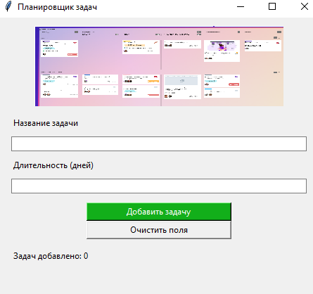

# Планировщик задач

Программа создано для планирования задач

# Участники

Пыжов Дмитрий - разработчик
Аймалетдинов Тимофей - тестировщик и заказчик

# ТЗ

Программа должна быть размером 460 на 520
Фото: любое по тематике
Поля ввода
Кнопки "Добавить задачу" и "Очистить поля"

## Инструкция для запуска

Откройте app.py в VS Code

## Скриншот

# Результат проверки
Всё работает корректно
